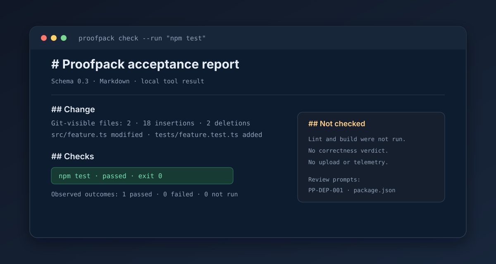

# Proofpack

**An evidence receipt for AI-assisted code changes.**

After a coding agent says "done", Proofpack shows what Git can see, which checks actually ran, and what remains unchecked. It runs locally, needs no account, and never gives a "safe to merge" verdict.

```sh
npx -y --package=proofpack-cli@0.3.2 proofpack check --run "npm test"
```

The command prints a Markdown report to stdout. Default inspection is read-only; `npm test` runs only because it was explicitly supplied with `--run`.



<details>
<summary>See the report text</summary>

```markdown
## Change
- Git-visible files: 2
- Diff summary: 18 insertions · 2 deletions

## Checks
- Explicit commands requested: 1
- Observed outcomes: 1 passed · 0 failed · 0 not run
- npm test: passed · exit 0

## Not checked
- Lint, build, dependency audits, and runtime behavior were not run.
```

</details>

Repository: [2648782102/proofpack-cli](https://github.com/2648782102/proofpack-cli) · npm: [proofpack-cli](https://www.npmjs.com/package/proofpack-cli) · Release: [v0.3.2](https://github.com/2648782102/proofpack-cli/releases/tag/v0.3.2)

## What it is for

Proofpack helps an individual developer answer three questions after a coding task: what changed, what checks actually ran, and what remains unchecked. It records Git change facts, explicit command evidence, and heuristic review prompts; it does not claim that a change is correct.

The report separates observed facts, heuristic prompts, and unchecked work. A passing command is evidence of that invocation only.

## Product principles

- One command, one readable report.
- Local by default; no account, daemon, model API, or upload.
- Observed facts, heuristic prompts, and unchecked work are separated.
- No project command runs unless the user explicitly supplies `--run`.
- Git inspection is read-only; explicitly run commands use the user's shell and privileges without a sandbox.

## Current distribution shapes

The `0.3.2` package contains both the `proofpack` CLI and the `proofpack-mcp` stdio entrypoint. MCP is a host-launched local subprocess, not a cloud service or a host plugin. See [docs/MCP.md](docs/MCP.md) for the protocol contract and host configuration.

## MCP quick start

After installing the package in a project, configure an MCP host to launch the local binary:

```json
{
  "mcpServers": {
    "proofpack": {
      "command": "npx",
      "args": ["-y", "--package=proofpack-cli@0.3.2", "proofpack-mcp"]
    }
  }
}
```

The host then sees one read-only `proofpack_check` tool. It generates a Markdown or JSON acceptance report without executing project commands or writing files.

## Install and first use

Use npm without a global install:

```sh
npx -y --package=proofpack-cli@0.3.2 proofpack check
```

Or install the package in a project:

```sh
npm install --save-dev proofpack-cli@0.3.2
npx proofpack check
```

The CLI binary is named `proofpack`; the MCP binary is named `proofpack-mcp`.

This prints a Markdown report to stdout without changing the working tree, running project commands, or making network requests. To save it, pass an explicit path:

```sh
npx -y --package=proofpack-cli@0.3.2 proofpack check --output .proofpack/review.md
```

## Explicit checks

```sh
npx -y --package=proofpack-cli@0.3.2 proofpack check --run "npm test" --run "npm run lint"
npx -y --package=proofpack-cli@0.3.2 proofpack check --run "npm test" --format json
npx -y --package=proofpack-cli@0.3.2 proofpack check --run "npm test" --format markdown,json --output .proofpack/review.md
```

Each command is previewed before execution, run sequentially from the repository root through the user's shell, and recorded with timing, exit status, bounded stdout/stderr, truncation, and best-effort redaction. `--timeout <seconds>` defaults to 120 and applies per command. Multiple formats require `--output` and write sibling `.md` / `.json` files.

Commands are not sandboxed and can modify the working tree. Review every command and its output before sharing a report. Passing checks are evidence of those invocations only, not proof of correctness or security.

## Branch/base and sharing

```sh
npx -y --package=proofpack-cli@0.3.2 proofpack check --base main
npx -y --package=proofpack-cli@0.3.2 proofpack check --run "npm test" --share-safe --output .proofpack/share.md
npx -y --package=proofpack-cli@0.3.2 proofpack check --output .proofpack/review.md --open
```

To render the report in Simplified Chinese, pass `--lang zh-CN` or set `PROOFPACK_LANG=zh-CN`. The default is English. This changes Markdown and JSON text fields only; schema keys, status values, paths, command stdout, and rule IDs stay unchanged.

```sh
npx -y --package=proofpack-cli@0.3.2 proofpack check --lang zh-CN
```

`--base` compares committed, staged, and working-tree changes against a resolved Git ref and excludes untracked files from that view. `--share-safe` omits branch, HEAD, base commit, file paths, output destination, command text, command output, and prompt evidence from both Markdown and JSON; status, counts, timings, and limitations remain. `--open` is opt-in, requires a written Markdown report, and uses the system opener. It never uploads the report.

Review even share-safe reports before sharing: omission is best-effort and aggregate metadata may still be sensitive.

## What it does not do

Proofpack does not discover or run package scripts automatically, infer test or build results, review code with an AI, assign a correctness score, approve changes, upload reports, collect telemetry, or sandbox explicit `--run` commands. Commands supplied with `--run` use the current user's shell and privileges.

The MCP adapter is narrower still: its single `proofpack_check` tool performs read-only Git inspection and does not execute project commands, write report files, open applications, make network requests, or invoke a model.

Early development: repository-local `init`, sandboxed execution, CI-result import, and agent-trace import are not implemented. See [roadmap](docs/ROADMAP.md) and [MCP contract](docs/MCP.md).

## Development

Requirements: Node.js 24 or newer.

```sh
npm install
npm run dev -- check
npm run check
npm test
npm run build
```

## Documents

- [Product requirements](docs/PRODUCT.md)
- [User experience](docs/UX.md)
- [CLI contract](docs/CLI.md)
- [MCP contract](docs/MCP.md)
- [Architecture](docs/ARCHITECTURE.md)
- [Security and privacy](docs/SECURITY.md)
- [Open-source references](docs/REFERENCES.md)
- [Roadmap](docs/ROADMAP.md)
- [Development handoff](docs/DEVELOPMENT.md)
- [Release checklist](docs/RELEASE.md)
- [0.3.1 release notes](docs/RELEASE_NOTES_v0.3.1.md)
- [0.3.2 release notes](docs/RELEASE_NOTES_v0.3.2.md)
- [Distribution and promotion](docs/DISTRIBUTION.md)
- [30-second demo script](scripts/demo.sh)
- [Changelog](CHANGELOG.md)
- [Decisions](docs/decisions/)

## License

MIT. See [LICENSE](LICENSE).
